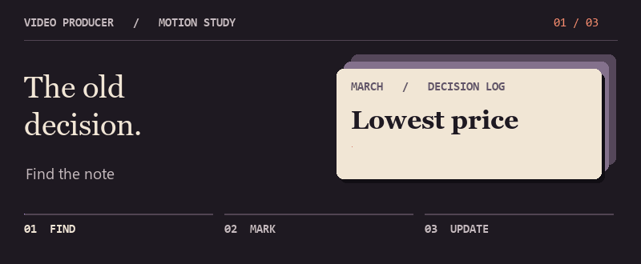

<p align="center"></p>

# Video Producer

**Turn a voice track into a Reel people can follow with their eyes.** Give your Codex or Claude assistant a recording and a brief. Video Producer helps it choose where to keep the presenter, when to show the actual product, and which idea needs animation. You get an MP4 and an editable project for the next revision.

[O‘zbekcha amaliy qo‘llanma](docs/reels-uz.md) · [First-cut playbook](plugins/video-producer/skills/video-producer/references/motion-reel.md) · [Install](#install) · [Technology](#what-runs-underneath)

## See what one sentence can do



> “In March we chose the cheapest plan. Then a customer asked for next-day delivery.”

Show the March note opening on **“cheapest plan.”** Cut to a hand marking the deadline on **“next-day delivery.”** Carry that mark into a diagram and show exactly which decision changes. Let the viewer read the result. These are three different shots with one continuous voice track.

The **motion-reel** workflow makes those decisions in the first cut. It also handles a small revision like “the music covers this word” using the existing timeline. For screen demos, interviews, subtitles and cinematic footage, the plugin has dedicated workflows. [Workflow examples](plugins/video-producer/skills/video-producer/references/routing.md)

## Try it on your footage

> Shu ovozimdan qiziqarli Reel tayyorla. Matn tasdiqlangan. Mahsulotni aytgan joyimda haqiqiy ekran yozuvini ishlat. Yangi fikrni diagrammada ochib ber. MP4, subtitr va tahrirlanadigan loyihani ber.

> Make a 30-second product demo from this screen recording. Start on the result, show the two clicks that produced it, and leave me the editable cut.

## How a Reel comes together

| Stage | What the assistant does |
| --- | --- |
| **Listen** | Inspects the supplied footage, keeps approved dialogue and marks the actual words that introduce each idea. |
| **Choose the shot** | Builds a timed shot list. A real app interaction demonstrates a feature, a cutaway shows a human action, and a diagram explains a relationship. |
| **Build the motion** | Times reveals and changes of focus to the voice. For a cloned presenter, selects calm intervals from original footage and prepares matching dialogue for the visible face windows. |
| **Finish and deliver** | Mixes around the speech, checks mouth timing and readability in playback, then checks the encoded file. Delivers the requested MP4, captions and editable timeline or edit plan. |

## Install

| Host | Installation |
| --- | --- |
| **Codex** | In Plugins, add `https://github.com/xamidjonovk/video-producer` as a marketplace and install **Video Producer**. Or use the CLI below. |
| **Claude Code** | Run `/plugin marketplace add xamidjonovk/video-producer`, then `/plugin install video-producer@video-producer`. |
| **Claude Desktop with Plugins** | In the Plugins settings, add the repository as a marketplace, sync, then install **Video Producer**. |

```sh
codex plugin marketplace add xamidjonovk/video-producer
codex plugin add video-producer@video-producer
```

Open a new task, supply your media and describe the edit in your language. For local rendering the assistant needs project-file and terminal access. With a checkout and Python 3.10+, you can also run `python install.py codex`, `python install.py claude`, or `python install.py both --project "/path/to/project"`. The fallback installer reports differing existing copies so you can preserve customizations.

## What runs underneath

| Technology | Its job |
| --- | --- |
| **Python + JSON** | The host assistant interprets the brief. The bundled Python planner selects stages and tool candidates. Job files hold the script, edit decisions, source times and sound layers so somebody else can revise the cut. |
| **FFmpeg + FFprobe** | Inspect streams, trim and assemble media, mix and duck sound, measure loudness and true peak, and decode-check the export. |
| **HyperFrames / Remotion** | HyperFrames renders timed HTML motion for diagrams, labels and UI callouts. Remotion handles React-driven graphics when the project benefits from them. The selected renderer is prepared on demand with Node.js 22+. |
| **faster-whisper / existing captions** | Recover speech timing locally when needed, or reuse supplied captions. The local model downloads on first use. |
| **ElevenLabs / Sync Lipsync 3** | Optional connected services for an authorized voice or new dialogue on an existing face. Local preparation pairs an excerpt of the original performance with the final voice. |
| **SQLite** | The bundled Higgsfield Shots helper tracks quotes, holds, takes and reviews across retries. Paid generation requires a live quote, account access and an authorized budget. |

### Run it from a checkout

```sh
python plugins/video-producer/skills/video-producer/vp.py doctor .
python plugins/video-producer/skills/video-producer/vp.py plan . motion-reel
python plugins/video-producer/skills/video-producer/vp.py plan . motion-reel presenter-clone
python plugins/video-producer/skills/video-producer/vp.py studio . init jobs/reel-01 --mode motion
```

`doctor` reports available capabilities. `plan` prints the steps and suitable tools. The assistant uses those tools in your media project to make the edit. Use `VIDEO_AGENT_FFMPEG` and `VIDEO_AGENT_FFPROBE` for existing binaries outside PATH. [Tool setup](plugins/video-producer/skills/video-producer/references/tools.md)

## Production guides

- **Direct a Reel** with a worked 15-second example, two sample revision requests and a copyable brief. [O‘zbekcha qo‘llanma](docs/reels-uz.md)
- **Work with a real presenter** from source selection through lip-sync review. [Presenter workflow](plugins/video-producer/skills/video-producer/references/presenter-clone.md)
- **Direct a generated film or shot** with reusable Soul Cinema character and location sheets, ImageGen props and MAGI-2 footage. [Cinematic workflow](plugins/video-producer/skills/video-producer/references/cinematic.md) · [Quotes and take receipts](plugins/video-producer/skills/higgsfield-shots/SKILL.md)
- **Use references and finish the edit** with sourced footage, an audio pass and playback checks. [References](plugins/video-producer/skills/video-producer/references/online.md) · [Finishing](plugins/video-producer/skills/video-producer/references/finishing.md) · [Publishing](plugins/video-producer/skills/video-producer/references/publish.md)

Code and templates use the [MIT license](LICENSE). Third-party tools and media are subject to their respective licenses. The filmstrip logo was created with OpenAI ImageGen. [Logo asset and creation prompt](docs/logo.md)
